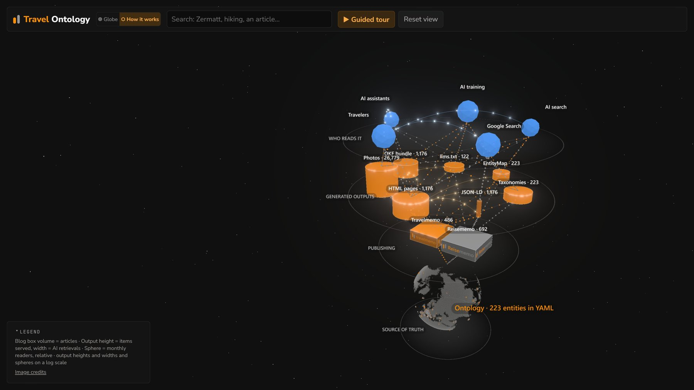
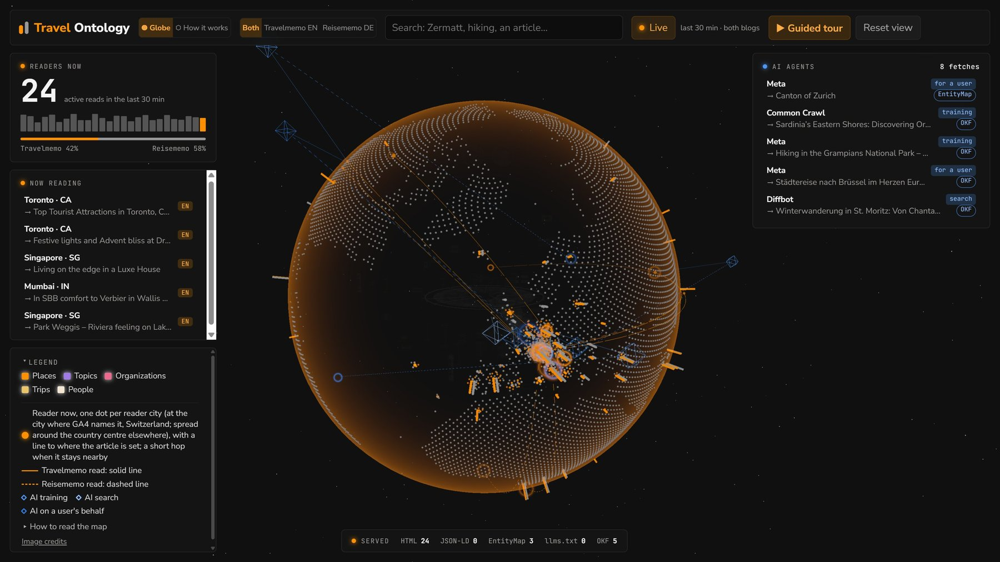

# Travel Ontology

Interactive 3D map of the knowledge graph behind
[travelmemo.com](https://travelmemo.com) and [reisememo.ch](https://reisememo.ch).
Every box is one entity from the ontology both blogs share: a place, a topic,
an organization, a trip or an author.

**Live:** https://webmemo-code.github.io/ontology-globe/

## Two views

**⬡ How it works.** The entities form a small globe: the ontology, the
single source of truth. Stacked above it are the two WordPress sites, the
generated outputs (JSON-LD, taxonomies, EntityMap, llms.txt, OKF) and the
groups that read them. Click any tile for a plain-language explanation.

**◍ Globe.** The small globe grows into the big one. It opens from outside,
with Switzerland facing you; fly inside to see the places hanging on their shells.

| Encoding | Meaning |
|---|---|
| Dot on the skin | One article at the place it is about (orange EN, grey DE); brightness and size = relative search tier |
| Bars on a country | Article count per blog on a log scale: orange Travelmemo, grey Reisememo |
| Dotted land | True geography (Natural Earth); a selected country is outlined |
| Boxes inside | Places on shells by level: continents nearest you, sights nearest the skin |
| Topic wheel | Topics stand on a level wheel inside the globe. Direction = family. Distance from the centre = articles on both blogs, on one log scale for all families: few near the hub, many towards the rim. The scale is a flat disc of soft bands, one per 1–9 of each decade, each fading in towards its end: like log paper, the bands narrow towards each decade's end, and the disc brightens towards the rim. The decades are labelled 1, 10, 100, 1000 articles. Height = how often AI agents fetched the topic in the last 30 days, stretched over the range of its class. Companies hang over their headquarters, the authors' faces at the zenith |
| Lens | Select a place to open its lens: the regions, towns and sights inside it with their article counts per blog, and the photos of its articles |
| Spotlight | Inside, entities are grey ghosts; colour follows the centre of the screen: places orange (deep to pale by level), topics violet by family, organizations rose, trips gold, people ivory |
| Flicker | An entity flickers in full colour while a reader or an AI agent is on it; from outside, an agent's fetch shows as a soft pulse on the skin above it |
| Gold tubes | Trips, drawn stop by stop in itinerary order |
| Halo / outline | Top 10% or top 25% search performer / orphan with no article yet |
| Select | An entity lights its article dots in gold (dim amber where filed under another country), with rays out to each; an article draws rays to its entities |

**● Live** (globe view, or `?live` in the URL): Readers of the last 30 minutes glow at their country, with a
flowing line to the article they read (GA4 Realtime): solid orange for Travelmemo,
dashed orange for Reisememo. AI agents are satellites coloured by purpose
(training, search, on a user's behalf): each hovers over the country its request
came from (Cloudflare on Travelmemo, IPinfo Lite on Reisememo) on a thin tether,
and beams to the article or entity it fetched from there. When the country is
unknown it hovers over the operator's headquarters instead.

Agents on article pages are not
seen, because the page cache serves those without PHP. `?live=demo` feeds
made-up traffic for previews and recordings.

## Lifted from the Periodic Cube of AI

Inspired by Walter's [Periodic Cube of AI](https://webmemo.ch/periodic-cube-of-ai)
