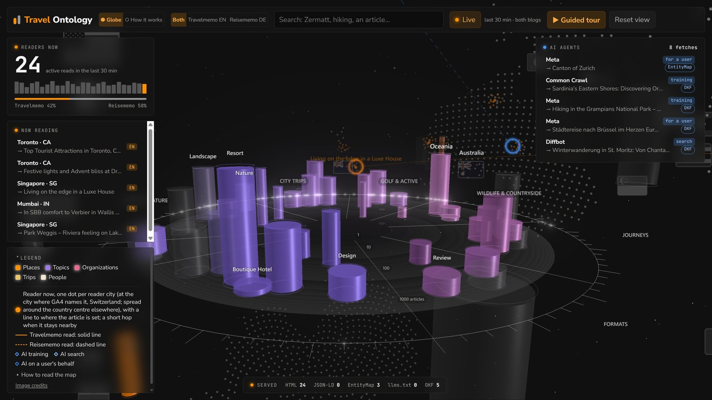
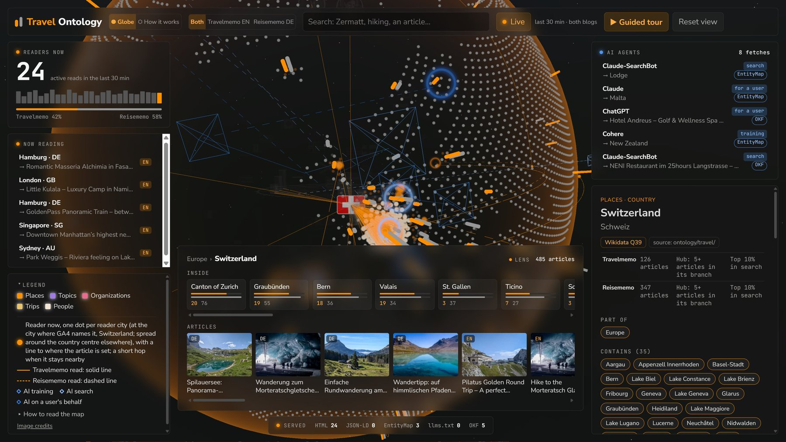
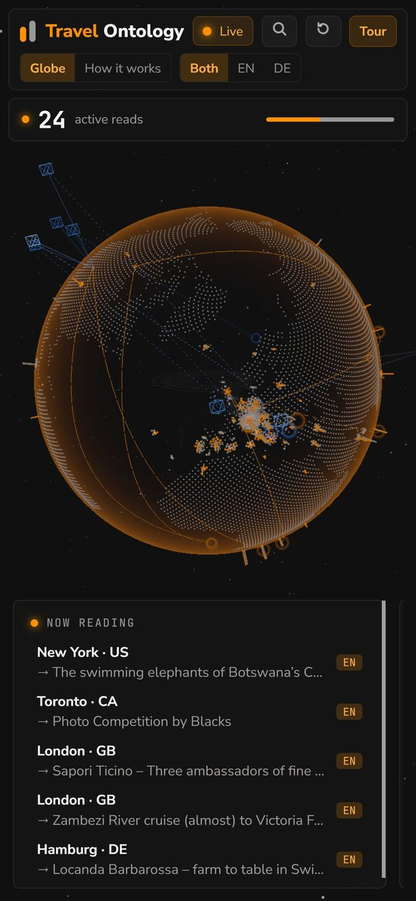

# Travel Graph Explorer

**Live:** [webmemo-code.github.io/travel-graph-explorer](https://webmemo-code.github.io/travel-graph-explorer/?live)

The interactive 3D graph explorer is based on data from 
[travelmemo.com](https://travelmemo.com) and [reisememo.ch](https://reisememo.ch).

Every cylinder is one entity from the ontology both blogs share: a place, a
topic, an organization, a trip or an author.

## Two views

**◍ Globe.** It opens from outside, with Switzerland facing you. Fly inside to
see the places hanging on their shells and the topics standing on a wheel in
the middle.

**⬡ How it works.** The ontology is a small globe, the single source of
truth. Stacked above it are the two WordPress sites, the generated outputs
(JSON-LD, taxonomies, EntityMap, llms.txt, OKF, photos) and the groups that
read them. Click any tile for a plain-language explanation.

## Reading the globe

**On the skin**

| Encoding | Meaning |
|---|---|
| Dotted land | True geography (Natural Earth); a selected country is outlined |
| Dot | One article at the place it is about (orange Travelmemo, grey Reisememo); brightness and size = relative search tier |
| Two bars on a country | Articles per blog on a log scale: orange Travelmemo, grey Reisememo |

**Inside**

| Encoding | Meaning |
|---|---|
| Cylinder | One entity. Width = articles; height = how often AI agents fetched it in the last 30 days, stretched over the range of its class; no fetches = a flat disc |
| Spotlight | Entities are grey ghosts; colour follows the centre of the screen. Places orange (deep to pale by level), topics violet by family, organizations rose, trips gold, people ivory. The selection, its neighbours and search hits stay lit. At most 8 labels at a time (5 on phones) |
| Flicker | An entity flickers in full colour while a reader or an AI agent is on it; from outside, an agent's fetch shows as a soft pulse on the skin above it |
| Place shells | Places by level: continents nearest you, sights nearest the skin. Countries carry their flag; companies hang over their headquarters with their logo |
| Topic wheel | Topics stand on a level wheel in the middle. Direction = family. Distance from the hub = articles on both blogs, on one log scale for all families: few near the hub, many towards the rim. The scale is a faint disc of bands that narrow towards each decade's end, like log paper, labelled 1, 10, 100, 1000 articles. The two authors hang just below its hub: every theme starts with them |
| Gold tubes | Trips, drawn stop by stop in itinerary order |
| Halo / outline | Top 10% or top 25% search performer / orphan with no article yet |

**Select** an entity (click it, search, or follow the guided tour, which opens below the equator looking up at Europe) and its
article dots light up, with rays out to each. A place also opens its **lens**:
the regions, towns and sights inside it with their article counts per blog,
and the photos of its articles. An article draws rays to its entities.
**Reset view** flies back to the start.

## Live

**Live** (the pill at the right of the top bar, globe view, or `?live` in the
URL). Off, it reads ▶ CONNECT LIVE; on, a green LIVE VISITORS, or amber with what
is missing while the feed is degraded (connecting, no feed, one blog only, AI
agents only). The panels around the globe show the active reads per blog, the
AI agents by purpose and what each output served; the globe is framed between
them.

- **Readers** of the last 30 minutes glow at their city, with a flowing line to
  the article they read (GA4 Realtime): solid orange for Travelmemo, dashed
  orange for Reisememo. The Now reading panel names their country in full
  ("Hamburg · Germany"); Swiss readers keep the short code ("Bern · CH").
- **AI agents** are satellites coloured by purpose (training, search, on a
  user's behalf). Each hovers over the country its request came from
  (Cloudflare on Travelmemo, IPinfo Lite on Reisememo) and beams to the article
  or entity it fetched. When the country is unknown it hovers over the
  operator's headquarters instead. Agents on article pages are not seen,
  because the page cache serves those without PHP. Each satellite and each row
  in the AI agents panel carries the company's site icon
  (`node scripts/fetch-bot-icons.mjs` refreshes them), its purpose and route
  as one line after the name, and a blue EN or grey DE chip saying which blog
  was fetched.
- **Follow** (in the Now reading header, on by default): the feed is checked
  every 30 seconds, and the camera flies to each newly seen reader or agent so
  their location and destination are both in view (just the destination when
  the arc runs behind the globe), then circles it slowly until the next one.
  The camera stays outside the globe: an agent fetching an entity is framed
  by its beam, from the satellite down to where it enters the globe. Dragging,
  selecting or the tour takes over; clicking any row frames its pair the same
  way.

## On a phone

The panels become a strip and swipeable cards (held sideways: the panels in
the left half, the globe in the right half). The top bar keeps Live, search,
Reset view and Tour as buttons.

## Lifted from the Periodic Cube of AI

Inspired by Walter's [Periodic Cube of AI](https://webmemo.ch/periodic-cube-of-ai)
